  

### 👋 Salut, moi c'est Tontongroudy

Étudiant en **cybersécurité à l'EFREI Bordeaux** (Bachelor Cybersécurité & Ethical Hacking, titre RNCP *Administrateur Systèmes, Réseaux et Cybersécurité*). Je m'intéresse surtout à la sécurité réseau, au scan de vulnérabilités et à l'automatisation d'audits.

**Je cherche une alternance de 24 mois à Bordeaux** pour mon Mastère Cybersécurité & Ethical Hacking (2026-2028), au rythme de **2 semaines en entreprise / 1 semaine à l'école**. Cybersécurité en priorité, mais je suis aussi ouvert aux postes en infrastructure et en support.

---

### Projets phares

| Projet | Description | Stack |
|--------|-------------|-------|
| [**ARC Scanner**](https://github.com/Tontongroudy/ARC-scanner) | Plateforme web de scan de vulnérabilités avec analyse IA et tickets temps réel. Développée en stage chez ARC Informatique (Dakar) | Node.js · Nmap · Nuclei · GPT-4o · SQLite · Socket.io |
| [**Infra réseau sécurisée**](https://github.com/Tontongroudy/Infras-R-seau-S-curis-es) | Réseau segmenté en 4 VLAN sous GNS3, attaques DHCP / ARP / MITM, puis durcissement (DHCP Snooping, DAI, IP Source Guard) | Cisco IOS · Scapy · Wireshark |
| [**aCropalypse PNG Generator**](https://github.com/Tontongroudy/aCropalypse_crop) | Reproduit la faille aCropalypse (CVE-2023-21036 / CVE-2023-28303) pour générer des échantillons de test forensic / CTF | Python · Pillow |
| [**Bissap Voice Changer**](https://github.com/Tontongroudy/bissap-voice-changer-by-groudy) | Modificateur de voix temps réel : 29 effets DSP, profils, soundboard | Python · NumPy · SciPy · CustomTkinter |

---

### Compétences

**Sécurité offensive & audit** 

**Réseau & systèmes** 

**Développement** 

---

### Expérience

- **ARC Informatique**, Dakar (Sénégal) : stages en cybersécurité. Surveillance systèmes et réseau, scans de vulnérabilités, support utilisateurs, développement d'**ARC Scanner**
- **Burotic Diffusion** : stage (2024)

